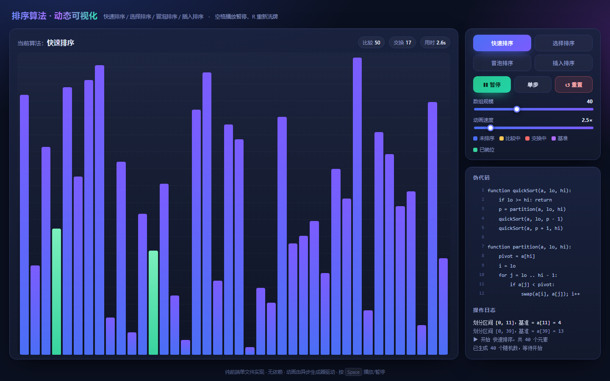

# 排序算法动态可视化

一个零依赖的单文件网页，用于**动态演示四种经典排序算法**的执行过程：快速排序、选择排序、冒泡排序、插入排序。

打开 `index.html` 即可使用，无需构建、无需联网。

> 在线演示：https://sun-shicheng.github.io/sorting-visualizer/



## 功能

- **四种算法一键切换**：快速排序、选择排序、冒泡排序、插入排序
- **逐帧动画**：比较（黄）、交换（红）、基准（紫）、已就位（绿）四色状态实时呈现，柱高随数据移动同步变化
- **伪代码联动高亮**：正在执行的代码行与动画逐步对应，便于对照理解
- **播放控制**：开始 / 暂停 / 单步 / 重置；暂停状态下可逐条单步执行
- **参数可调**：数组规模 8–100，动画速度 0.2–20×
- **实时统计**：比较次数、交换次数、耗时，外加关键步骤日志（如「划分区间 [5,15]，基准 = a[15] = 14」）
- **键盘快捷键**：`Space` 播放 / 暂停，`R` 重新洗牌

## 使用

直接双击 `index.html`，或在浏览器中打开。也可起一个静态服务器：

```bash
python -m http.server 8000
# 访问 http://localhost:8000
```

## 实现说明

页面内部用一个 `async function*` 生成器描述每个算法，算法每执行一步就 `yield` 一个描述对象（比较 / 交换 / 基准 / 就位 / 对应伪代码行号），由统一的播放器按速度间隔消费并渲染。这样做的好处是**算法逻辑与动画渲染完全解耦**，新增算法只需再写一个生成器，不必改动 UI 或播放器。

```js
async function* quickSortGen(a, lo, hi) { /* yield { cmp } / { swap } / { pivot } ... */ }
```

## 算法对比

| 算法 | 最好 | 平均 | 最坏 | 空间 | 稳定性 |
| --- | --- | --- | --- | --- | --- |
| 快速排序 | O(n log n) | O(n log n) | O(n²) | O(log n) | 不稳定 |
| 选择排序 | O(n²) | O(n²) | O(n²) | O(1) | 不稳定 |
| 冒泡排序 | O(n) | O(n²) | O(n²) | O(1) | 稳定 |
| 插入排序 | O(n) | O(n²) | O(n²) | O(1) | 稳定 |

## 文件结构

```
sorting-visualizer/
├── index.html   # 全部内容：HTML + CSS + JS，单文件、无依赖
└── README.md
```

## License

MIT
